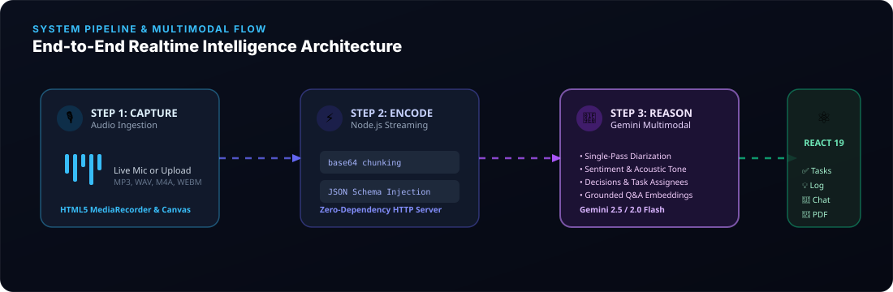
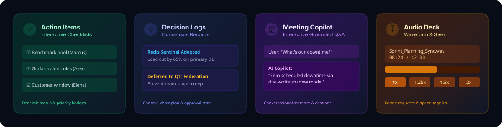

<div align="center">

  <!-- Animated Hero SVG Banner -->
  

  <br/><br/>

  <!-- Shields & Badges -->
  <p align="center">
    <a href="https://react.dev"></a>
    <a href="https://ai.google.dev"></a>
    <a href="https://vitejs.dev"></a>
    <a href="https://nodejs.org"></a>
    <a href="./LICENSE"></a>
    
  </p>

  <p align="center">
    <b>⚡ Transform unstructured meeting audio into structured executive intelligence, decision logs, and interactive action items with zero latency.</b>
  </p>

  <p align="center">
    <a href="#-quick-start">🚀 Quick Start</a> •
    <a href="#-system-architecture">🏗️ Architecture</a> •
    <a href="#-key-features">✨ Features</a> •
    <a href="#-meeting-archetypes">🎯 Archetypes</a> •
    <a href="#-standalone-python-cli">🐍 Python CLI</a> •
    <a href="#-privacy--security">🔒 Security</a>
  </p>

</div>

---

## ⚡ System Pipeline & Multimodal Flow

<div align="center">
  
</div>

---

## 💎 Feature Highlights

<div align="center">
  
</div>

<br/>

| Feature | Description | Highlight |
|---|---|---|
| 🎙️ **Live Microphone Capture** | In-browser audio streaming with animated frequency wave visualizer | Zero external audio setup needed |
| 📁 **Universal Audio Support** | Direct multimodal ingestion for MP3, WAV, M4A, AAC, OGG, WEBM, FLAC | Single-pass acoustic processing |
| ✅ **Interactive Task Tracker** | Action item checklist with assignees, due dates, priority badges (`High`, `Med`, `Low`) | Check off completed tasks with progress stats |
| 💡 **Consensus & Decision Log** | Automatic identification of key agreements, rationale, owner, and status | Never lose architectural context |
| 📊 **Topic-by-Topic Breakdown** | Segmented discussion agenda with timestamps and summaries | Quick skimming for stakeholders |
| 💬 **Ask Meeting AI (Copilot)** | Grounded conversational assistant answering specific questions about the session | Conversational memory & quotes |
| 📥 **Export to Markdown & PDF** | 1-click formatted Markdown, print-ready PDF, or structured JSON export | Ready for Notion, Jira, Slack |

---

## 🚀 Quick Start

### 1. Prerequisites
- **Node.js**: v18+ (Node.js v24 recommended)
- **Google Gemini API Key**: Free key from [Google AI Studio](https://aistudio.google.com/app/apikey)

### 2. Launch the Application

#### Option A: 1-Click Launch (Windows)
Double-click [**`start.bat`**](./start.bat). It boots the server and opens your browser at `http://localhost:3000`.

#### Option B: Terminal Command
```bash
# 1. Install dependencies
npm install

# 2. Build React production bundle
npm run build

# 3. Start local server
node server.js
```
Open **[http://localhost:3000](http://localhost:3000)** in your browser.

#### Option C: Development Mode (Hot Reload)
```bash
npm run dev
```

---

## 🎯 Specialized Meeting Archetypes

Tailor the GenAI extraction model to your specific meeting dynamic:

```
  ┌─────────────────────────────────────────────────────────────┐
  │ 📝 Comprehensive Minutes  │ Balanced full organizational record
  │ 📌 Executive Briefing     │ C-Suite TL;DR, financial KPIs & ARR
  │ 🏃 Agile / Daily Scrum    │ Updates, blockers & sprint goals   │
  │ 🛠️ Architecture Review    │ ADRs, database latency & API specs │
  │ 🤝 Client Discovery       │ Pain points, budget & deal roadmap │
  └─────────────────────────────────────────────────────────────┘
```

---

## 🐍 Standalone Python CLI

For automated CI/CD pipelines, cron jobs, or command-line workflows, a standalone Python CLI is included:

```powershell
# Set your API key
$env:GEMINI_API_KEY="your_api_key_here"

# Summarize audio file to Markdown
python cli/summarizer.py path/to/meeting.mp3 --type "Engineering & Architecture" -o notes.md

# Output structured JSON
python cli/summarizer.py path/to/meeting.wav --json > meeting.json
```

---

## ⚖️ Why OmniNote AI vs. Traditional Solutions

```
Traditional Pipeline (3 Models)          OmniNote AI (1 Multimodal Pass)
┌───────────────────────┐               ┌─────────────────────────────────┐
│ Raw Meeting Audio     │               │ Raw Meeting Audio               │
└──────────┬────────────┘               └────────────────┬────────────────┘
           ▼                                             │
┌───────────────────────┐                                │
│ Speech-to-Text        │                                │ Single Multimodal Pass:
│ (Whisper STT)         │                                │ • Speech-to-text
└──────────┬────────────┘                                │ • Speaker Diarization
           ▼                                             │ • Acoustic Tone & Emotion
┌───────────────────────┐                                │ • Structured Decisions & Tasks
│ Speaker Clustering    │                                │ • Grounded Q&A Memory
│ (PyAnnote Diarization)│                                │
└──────────┬────────────┘                                │
           ▼                                             │
┌───────────────────────┐                                ▼
│ Text Summarization    │               ┌─────────────────────────────────┐
│ (LLM Text Prompt)     │               │ Structured React Intelligence   │
└──────────┬────────────┘               └─────────────────────────────────┘
           ▼                                       ⚡ < 15 Seconds
┌───────────────────────┐
│ Plain Text Output     │
└───────────────────────┘
  ⚠️ 3-5 Mins + Lost Tone
```

---

## 🔒 Privacy & Security

- **Local First**: Runs entirely on your local machine (`localhost:3000`).
- **Encrypted In-Transit**: Audio streams communicate directly with Google Gemini over TLS 1.3 HTTPS.
- **In-Memory Processing**: Audio files are analyzed in memory and never permanently stored on third-party servers.
- **Zero Credential Exposure**: `.env` is isolated locally and protected by `.gitignore`.

---

## 📄 License
This project is open-source under the **[MIT License](./LICENSE)**.

<div align="center">
  <sub>Engineered with ❤️ using React 19, Vite, and Google Gemini Multimodal GenAI.</sub>
</div>
