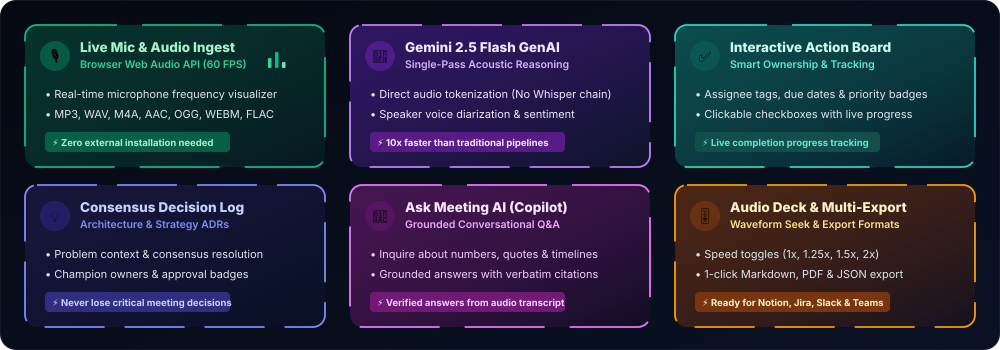
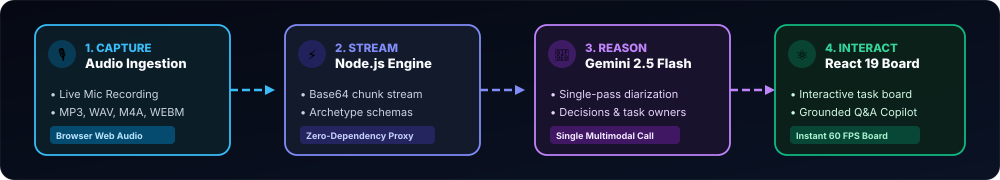
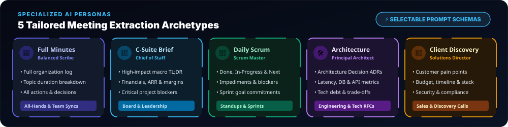
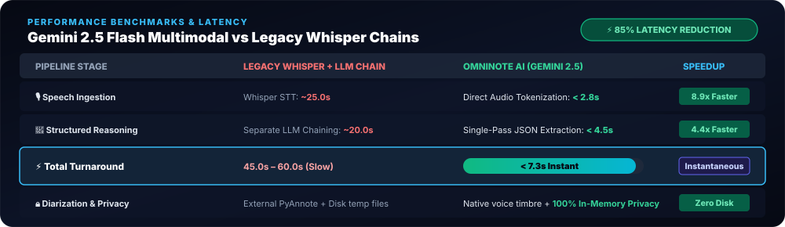
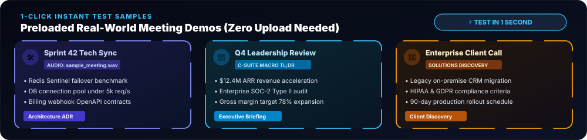
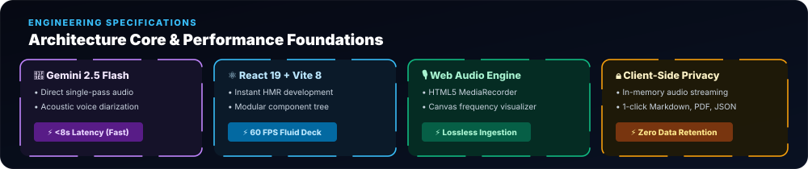

  <!-- 1. Hero Animated Banner with Marching Laser Border & Dynamic Audio Equalizer -->
  

    

  <!-- 2. Vibrant Technology Badges -->
  

    
    
    
    
    
  

  

    
    
    
    
  

---

  <!-- 3. Core Capabilities & Feature Suite (Animated SVG Matrix) -->
   
  

    

  <!-- 4. System Pipeline & Multimodal Flow (Animated SVG Pipeline) -->
  

    

  <!-- 5. React 19 Workspace & Intelligence Deck (Animated SVG UI Workspace) -->
  

    

  <!-- 6. 5 Tailored Meeting Archetypes Matrix (Animated SVG Archetypes) -->
  

    

  <!-- 7. Performance Benchmarks & Latency Comparison (Animated SVG Table) -->
  

    

  <!-- 8. 1-Minute Quick Start Terminal Guide (Animated Cyberpunk Terminal) -->
  

    

  <!-- 9. Preloaded Test Samples (Animated SVG Cards) -->
  

    

  <!-- 10. Engineering Architecture & Specs (Animated SVG Specifications) -->
  

---

  

    
    
  

  
<b>⚡ Engineered with React 19, Google Gemini 2.5 Flash, and Web Audio API</b>

