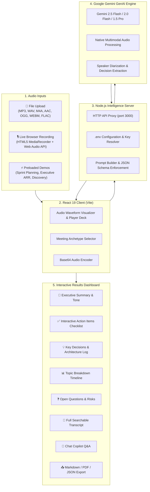

# 🎙️ OmniNote AI: Meeting Notes Summarizer from Audio (GENAI + React 19)

> **Modern, full-stack AI Meeting Intelligence application powered by Google Gemini Multimodal GenAI (`gemini-2.5-flash`, `gemini-2.0-flash`, `gemini-1.5-pro`) and React 19.**
> Transcribe, diarize speakers, track consensus decisions, extract action items, and converse with your meeting records in real-time.

---

## 📑 Table of Contents
- [Overview](#-overview)
- [System Architecture](#-system-architecture)
- [Key Features](#-key-features)
- [React Component Hierarchy](#-react-component-hierarchy)
- [Quick Start Guide](#-quick-start-guide)
  - [Prerequisites](#prerequisites)
  - [1-Click Windows Launch](#1-click-windows-launch)
  - [Production Mode](#production-mode)
  - [Development Mode (HMR)](#development-mode-hmr)
- [Configuration & Environment](#-configuration--environment)
- [Meeting Archetypes & Prompts](#-meeting-archetypes--prompts)
- [Interactive Features](#-interactive-features)
- [Standalone Python CLI](#-standalone-python-cli)
- [API Reference](#-api-reference)
- [Security & Privacy](#-security--privacy)
- [License](#-license)

---

## 🌟 Overview

Traditional meeting summarization systems require brittle, multi-stage pipelines: audio transcription using speech-to-text models (Whisper), followed by separate speaker diarization scripts, followed by LLM summarization prompts.

**OmniNote AI** leverages **Google Gemini's native Multimodal Audio Understanding**:
- **Single-Pass Inference**: Transcribes speech, identifies speaker voices, detects sentiment, and generates structured executive intelligence in a single API call.
- **Acoustic Nuance**: Captures vocal inflection, skepticism, consensus, and emotional emphasis that text-only transcriptions lose.
- **Zero Heavy Native Dependencies**: Runs without local ffmpeg binaries or heavy PyTorch models.

---

## 🏗️ System Architecture



---

## ✨ Key Features

### 1. In-Browser Microphone Recording
- Live microphone streaming with real-time audio frequency visualizer on an HTML5 `<canvas>`.
- Elapsed recording timer with pause, resume, and instant one-click analysis.

### 2. Audio Playback Bar
- Custom audio player deck with seek slider, progress counters (`MM:SS / MM:SS`), and variable playback speed controls (`1x`, `1.25x`, `1.5x`, `2x`).

### 3. Five Specialized Meeting Archetypes
Tailor the GenAI extraction persona to your specific session:
- 📝 **Comprehensive Meeting Minutes**: Balanced record for organizational distribution.
- 📌 **Executive Briefing**: C-Suite TL;DR, financial KPIs, ARR metrics, and strategic milestones.
- 🏃 **Agile / Daily Scrum**: Completed tasks, in-progress items, blockers, and sprint goals.
- 🛠️ **Engineering & Architecture**: Architecture Decision Records (ADRs), trade-offs, database metrics, and API specs.
- 🤝 **Client Discovery & Sales**: Client pain points, current stack, security requirements, and deal timelines.

### 4. Interactive Action Items & Task Tracker
- Check off completed deliverables with dynamic visual strikethrough.
- Filter tasks instantly by **All**, **Pending**, **Completed**, or **High Priority**.
- Every task includes an **Assignee tag**, **Due date**, and **Priority badge** (`High`, `Medium`, `Low`).

### 5. Interactive "Chat with Meeting AI" (Copilot)
- Ask natural language questions grounded in the meeting discussion:
  - *"What did Marcus say about the Redis cache sizing?"*
  - *"List all commitments with deadlines before Nov 25."*
  - *"What was the rationale behind deferring GraphQL federation?"*

### 6. One-Click Preloaded Demonstrations
Test the application immediately without uploading an audio file:
- **Demo 1**: *Q4 Architecture & Sprint Modernization* (Engineering lead, Product manager, Backend architect).
- **Demo 2**: *Executive Leadership & Q3 ARR Review* (CEO, CFO, CMO reviewing financial performance).
- **Demo 3**: *FinCorp Global Enterprise Discovery* (CISO and Solutions team evaluating compliance).

---

## 🧩 React Component Hierarchy

```
src/
├── main.jsx                     # Application bootstrap with StrictMode
├── App.jsx                      # Root state: audio blobs, results, active tabs, settings
├── index.css                    # Glassmorphism dark styling & PDF print rules
├── components/
│   ├── Header.jsx               # Header, Gemini status badge, settings button
│   ├── AudioUploader.jsx        # Drag-and-drop audio file upload dropzone
│   ├── AudioRecorder.jsx        # HTML5 MediaRecorder + Web Audio canvas visualizer
│   ├── DemoSelector.jsx         # 3 interactive sample meeting cards
│   ├── AudioPlayerDeck.jsx      # Audio playback bar with seek slider & speed buttons
│   ├── MeetingHero.jsx          # Title, sentiment, executive summary & export bar
│   ├── ActionItemsTab.jsx       # Interactive task checklist with filters & check-offs
│   ├── DecisionsTab.jsx         # Consensus log with rationale & approval badges
│   ├── TopicsTab.jsx            # Segmented discussion timeline
│   ├── QuestionsTab.jsx         # Unresolved questions & risk items
│   ├── TranscriptTab.jsx        # Searchable speaker transcript
│   ├── ChatCopilotTab.jsx       # Conversational AI Q&A copilot
│   └── SettingsModal.jsx        # API key input and model selector
└── utils/
    └── exportUtils.js           # Markdown generation, file download & byte formatting
```

---

## 🚀 Quick Start Guide

### Prerequisites
- **Node.js**: v18+ (Node.js v24 recommended)
- **Gemini API Key**: Free key from [Google AI Studio](https://aistudio.google.com/app/apikey)

### 1-Click Windows Launch
Double-click [**`start.bat`**](file:///c:/Users/nived/OneDrive/Documents/audio/start.bat) in the project folder. It launches the server and opens your browser at `http://localhost:3000`.

### Production Mode
```powershell
# 1. Build the React application
npm run build

# 2. Start the production server
node server.js
```
Open **[http://localhost:3000](http://localhost:3000)** in your browser.

### Development Mode (HMR)
```powershell
# Run the Vite development server with instant Hot Module Replacement
npm run dev
```

---

## ⚙️ Configuration & Environment

Create a `.env` file in the root directory (or use the built-in UI settings modal):

```env
# Google Gemini API Key
GEMINI_API_KEY=AIzaSy...

# Local server port (default: 3000)
PORT=3000
```

Supported Gemini Models:
- `gemini-2.5-flash` *(Default & Recommended - Ultra-fast multimodal audio inference)*
- `gemini-2.0-flash` *(Next-generation multimodal reasoning)*
- `gemini-1.5-flash` *(Lightweight, cost-effective)*
- `gemini-1.5-pro` *(Complex reasoning for long meetings up to 9.5 hours)*

---

## 🐍 Standalone Python CLI

For automated CI/CD pipelines, bash scripts, or terminal workflows, a standalone Python CLI is included:

```powershell
# Set your API key
$env:GEMINI_API_KEY="your_api_key_here"

# Summarize an audio file to Markdown
python cli/summarizer.py path/to/meeting.mp3 --type "Engineering & Architecture" -o notes.md

# Output raw JSON
python cli/summarizer.py path/to/meeting.wav --json > meeting.json
```

**CLI Arguments**:
| Flag | Description | Default |
|---|---|---|
| `audio_file` | Path to audio file (MP3, WAV, M4A, AAC, etc.) | *Required* |
| `--model` | Gemini model name | `gemini-2.5-flash` |
| `--type` | Meeting archetype persona | `Comprehensive Minutes` |
| `--prompt` | Custom focus instruction | `""` |
| `-o, --output`| File path to save Markdown notes | `stdout` |
| `--json` | Output raw structured JSON | `false` |

---

## 📡 API Reference

The local server exposes clean JSON REST endpoints:

### `GET /api/health`
Returns service uptime and Node.js version.

### `GET /api/config`
Returns active model list and whether a `.env` key is configured.

### `POST /api/save-key`
Persists the user's Gemini API key to `.env`.
```json
{
  "apiKey": "AIzaSy..."
}
```

### `POST /api/summarize-audio`
Analyzes audio base64 payload and returns structured intelligence.
```json
{
  "audioBase64": "<base64_string>",
  "mimeType": "audio/mp3",
  "model": "gemini-2.5-flash",
  "meetingType": "Engineering & Architecture",
  "customPrompt": "Focus on database latency",
  "apiKey": "optional_override_key"
}
```

### `POST /api/chat`
Answers conversational questions about the meeting.
```json
{
  "meetingSummary": { ... },
  "userQuestion": "Who owns the Grafana dashboard?",
  "chatHistory": [ ... ],
  "model": "gemini-2.5-flash"
}
```

---

## 🔒 Security & Privacy

1. **Local Execution**: The server runs completely locally on `localhost`.
2. **Encrypted Transport**: Audio data is dispatched directly to Google Gemini API over encrypted TLS 1.3 HTTPS connections.
3. **Zero Retention Model**: Meeting recordings are processed in-memory and are not stored permanently on remote servers.
4. **Credential Protection**: `.env` is ignored by default in `.gitignore`.

---

## 📄 License
This project is open-source under the **MIT License**.
