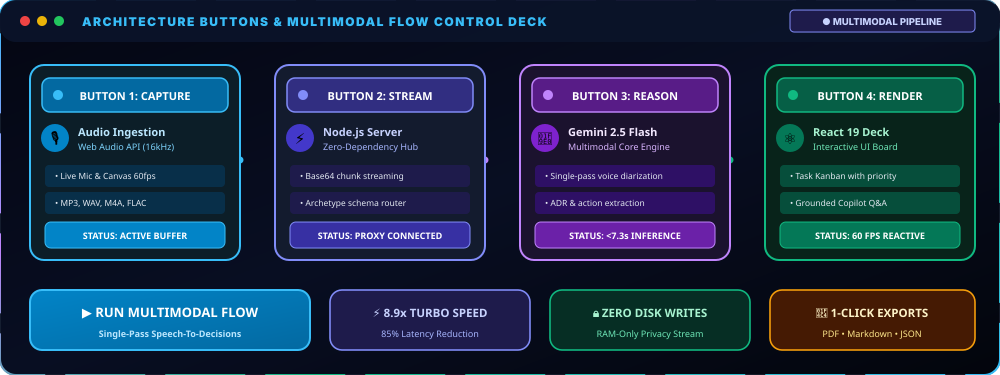
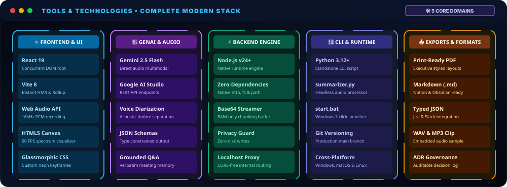
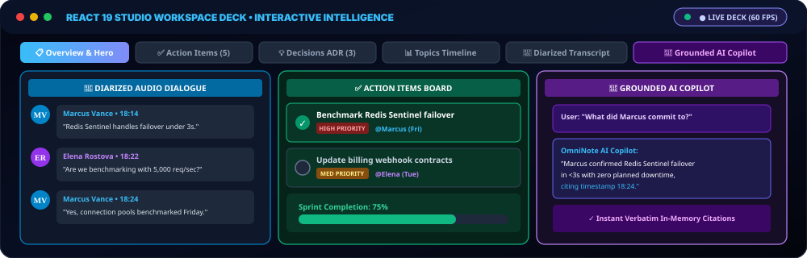
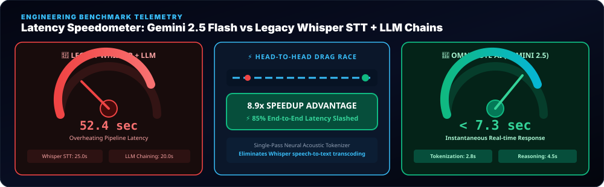
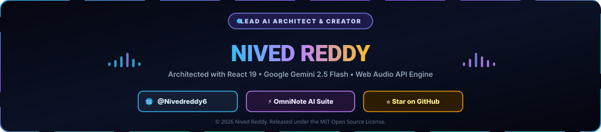

<a id="top"></a>
<div align="center">

  <!-- Hero Animated Banner with Marching Laser Border & Dynamic Audio Equalizer -->
  

  <br/><br/>

  <!-- Vibrant Technology Badges -->
  <p align="center">
    <a href="https://react.dev"></a>
    <a href="https://ai.google.dev"></a>
    <a href="https://vitejs.dev"></a>
    <a href="https://nodejs.org"></a>
    <a href="./LICENSE"></a>
  </p>

  <p align="center">
    
    
    
    
  </p>

  <h3><b>⚡ Transform unstructured meeting recordings and live microphone streams into executive intelligence, consensus decisions, interactive task boards, and grounded conversational Q&amp;A.</b></h3>

  <br/>

  <!-- Interactive Quick-Navigation Pill Buttons Deck (Clickable Anchors) -->
  <p align="center">
    <a href="#quickstart"></a>
    &nbsp;
    <a href="#architecture"></a>
    &nbsp;
    <a href="#features"></a>
    &nbsp;
    <a href="#tools-and-technologies"></a>
    &nbsp;
    <a href="#archetypes"></a>
  </p>
  <p align="center">
    <a href="#workspace"></a>
    &nbsp;
    <a href="#benchmarks"></a>
    &nbsp;
    <a href="#samples"></a>
    &nbsp;
    <a href="#repository"></a>
  </p>

</div>

---

<a id="architecture"></a>
## 🏗️ Architecture & Multimodal Data Flow

<div align="center">
  <!-- Interactive Control Buttons & Multimodal Pipeline Flow -->
  

  <br/><br/>

  <!-- End-to-End System Architecture Schematic Flow -->
  
</div>

<p align="right"><a href="#top"></a></p>

---

<a id="tools-and-technologies"></a>
## 🛠️ Tools & Technologies Ecosystem

<div align="center">
  <!-- 5-Domain Tools and Technologies Ecosystem Matrix -->
  
</div>

<p align="right"><a href="#top"></a></p>

---

<a id="repository"></a>
## 📁 Repository Directory Structure

<div align="center">
  <!-- Animated Cyberpunk Repository Tree Terminal with Marching Laser & Blinking Cursor -->
  
</div>

<p align="right"><a href="#top"></a></p>

---

<a id="features"></a>
## ✨ Core Features & Intelligence Suite

<div align="center">
  <!-- Apple/Linear Style Bento Grid with 6 Radically Distinct Interactive Widgets -->
  
</div>

<p align="right"><a href="#top"></a></p>

---

<a id="workspace"></a>
## 🖥️ React 19 Workspace & Interactive Tabs

<div align="center">
  <!-- React 19 Studio Console: Diarized Dialogue Stream, Interactive Action Board & Grounded AI Copilot -->
  
</div>

<p align="right"><a href="#top"></a></p>

---

<a id="archetypes"></a>
## 🎯 5 Specialized Meeting Archetypes

<div align="center">
  <!-- 5 Radically Distinct Persona Artifacts: Legal Scroll, Luxury Gold Card, Agile Scrum Board, Blueprint ADR, Sales Discovery -->
  
</div>

<p align="right"><a href="#top"></a></p>

---

<a id="benchmarks"></a>
## ⚡ Performance Benchmarks & Latency Advantage

<div align="center">
  <!-- Dual Speedometer Telemetry Latency Drag Race: Gemini 2.5 Flash vs Legacy Whisper STT Chains -->
  
</div>

<p align="right"><a href="#top"></a></p>

---

<a id="quickstart"></a>
## 🚀 Quick Start Guide (1-Minute Setup)

<div align="center">
  <!-- Cyberpunk Terminal Quick Start Guide -->
  
</div>

<br/>

### 1. Clone & Enter
```bash
git clone https://github.com/Nivedreddy6/Meeting-Notes-Summarizer-from-Audio.git
cd Meeting-Notes-Summarizer-from-Audio
```

### 2. Install Dependencies
```bash
npm install
```

### 3. Set API Key
Create a `.env` file in the root directory:
```env
GEMINI_API_KEY=your_gemini_api_key_here
PORT=3000
```
*(You can also paste your API key directly in the web UI via the Settings modal).*

### 4. Launch OmniNote
- **Windows 1-Click Launch**: Double-click `start.bat`
- **Production Server**: `npm run build && node server.js`
- **Development Mode**: `npm run dev`

Open **`http://localhost:3000`** in your browser.

<p align="right"><a href="#top"></a></p>

---

<a id="samples"></a>
## 📦 Instant Test Samples (Zero Audio Required)

<div align="center">
  <!-- Preloaded Demo Cartridges Showcase -->
  
</div>

<p align="right"><a href="#top"></a></p>

---

## 🔒 Security & Client Privacy

<p align="center">
  
  
  
</p>

---

<div align="center">
  <!-- Animated Footer Signature by Nived Reddy -->
  
</div>
