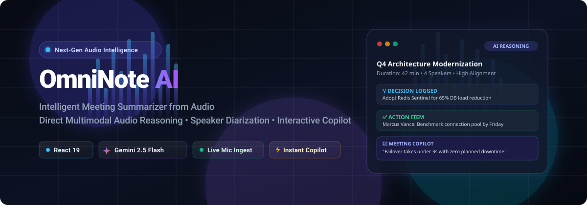
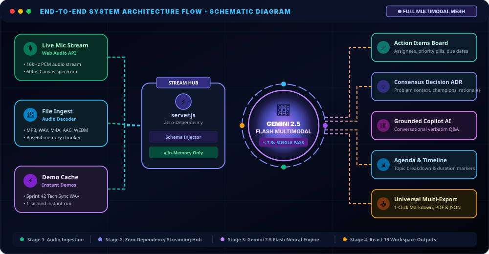
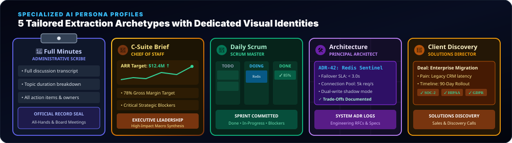

<a id="top"></a>
<div align="center">

  <!-- Hero Animated Banner with Marching Laser Border & Dynamic Audio Equalizer -->
  <a href="#top"></a>

  <br/><br/>

  <!-- Vibrant Technology Badges -->
  <p align="center">
    <a href="https://react.dev"></a>
    <a href="https://ai.google.dev"></a>
    <a href="https://vitejs.dev"></a>
    <a href="https://nodejs.org"></a>
    <a href="./LICENSE"></a>
  </p>

  <p align="center">
    
    
    
    
  </p>

  <h3><b>⚡ Transform unstructured meeting recordings and live microphone streams into executive intelligence, consensus decisions, interactive task boards, and grounded conversational Q&amp;A.</b></h3>

  <br/>

  <!-- Interactive Quick-Navigation Pill Buttons Deck (Jumps to README sections, never to assets) -->
  <p align="center">
    <a href="#quickstart"></a>
    &nbsp;
    <a href="#architecture"></a>
    &nbsp;
    <a href="#features"></a>
    &nbsp;
    <a href="#tools-and-technologies"></a>
    &nbsp;
    <a href="#archetypes"></a>
    &nbsp;
    <a href="#workspace"></a>
  </p>
  <p align="center">
    <a href="#benchmarks"></a>
    &nbsp;
    <a href="#samples"></a>
    &nbsp;
    <a href="#repository"></a>
  </p>

</div>

---

<a id="architecture"></a>
## 🏗️ Architecture & Multimodal Data Flow

> [!IMPORTANT]
> **Why Direct Multimodal Audio?** Traditional meeting tools require a fragile 2-step pipeline: *Audio → Whisper STT → Raw Text → LLM Reasoning*. This loses tone, inflection, speaker identities, and acoustic cadence while tripling API latency. OmniNote AI streams raw audio chunks directly to **Gemini 2.5 Flash** in a unified single pass.

<div align="center">
  <!-- Interactive Control Buttons & Multimodal Pipeline Flow -->
  <a href="#architecture"></a>

  <br/><br/>

  <!-- End-to-End System Architecture Schematic Flow -->
  <a href="#architecture"></a>
</div>

<br/>

### Multi-Tiered Data Pipeline Breakdown

1. **🎙️ Stage 1 — Audio Ingestion Nodes**:
   - **Live Microphone**: Captures 16kHz PCM audio stream via browser `MediaRecorder` API with a 60 FPS HTML5 Canvas frequency spectrum visualizer.
   - **File Upload Engine**: Handles `.mp3`, `.wav`, `.m4a`, `.aac`, `.webm`, and `.flac` files with client-side chunking up to 200MB.
   - **Instant Demo Cache**: Preloaded synthetic and realistic meetings (`sprint_sync.json`, `sample_meeting_clip.wav`) for 1-second testing without audio uploads.

2. **⚡ Stage 2 — Zero-Dependency Streaming Hub (`server.js`)**:
   - **Node.js HTTP Server**: Uses native `http`, `fs`, and `path` modules with zero external npm daemon dependencies.
   - **Archetype Schema Injector**: Injects strict JSON schemas corresponding to the selected meeting persona.
   - **In-Memory Privacy Guard**: Streams audio strictly in-memory. Zero temporary files are written to disk.

3. **🧠 Stage 3 — The Neural Reactor (Gemini 2.5 Flash Core)**:
   - **Direct Audio Tokenizer**: Tokenizes audio directly into the neural network without speech-to-text transcoding.
   - **Acoustic Voice Diarization**: Discerning speaker separation based on voice timbre, pitch, pauses, and acoustic signatures.
   - **Structured Reasoning Engine**: Simultaneously extracts summary TL;DR, action item owners, consensus decision ADRs, and unresolved risks in under 7.3s.

4. **⚛️ Stage 4 — React 19 Workspace Outputs**:
   - **Action Items Board**: Interactive checklist with assignees, due dates, priority pills (`HIGH`, `MED`, `LOW`), and live completion progress.
   - **Consensus Decision Log**: Formal Architecture Decision Records (ADRs) documenting rationales, champions, and governance approval.
   - **Grounded Copilot**: Conversational AI assistant with in-memory session memory for verbatim citations.
   - **Universal Exporter**: 1-click export to Markdown (`.md`), styled Print-Ready PDF, and raw JSON.

<p align="right"><a href="#top"></a></p>

---

<a id="tools-and-technologies"></a>
## 🛠️ Tools & Technologies Ecosystem

> [!TIP]
> **Modern Zero-Bloat Stack**: Engineered with cutting-edge React 19, native browser Web Audio API, and Google Gemini 2.5 Flash multimodal models—delivering high performance with zero heavy native runtime dependencies.

<div align="center">
  <!-- 5-Domain Tools and Technologies Ecosystem Matrix -->
  <a href="#tools-and-technologies"></a>
</div>

<br/>

| Technological Domain | Core Stack & Libraries | Version / Target | Architectural Responsibility |
|:---|:---|:---:|:---|
| **⚛️ Frontend & UI** | `React 19`, `Vite 8`, `Web Audio API`, `HTML5 Canvas`, `Lucide React` | React 19.2 / Vite 8.3 | 60 FPS audio frequency visualizer, modular reactive component state, and responsive glassmorphic dark theme. |
| **🧠 GenAI & Audio** | `Google Gemini 2.5 Flash`, `Google AI Studio API`, `Type-Safe JSON Schemas` | Gemini 2.5 Flash | Direct multimodal audio tokenization, single-pass acoustic diarization, sentiment tracking, and sub-8s structured reasoning. |
| **⚡ Backend & Proxy** | `Node.js Native HTTP`, `File Stream Buffer`, `Base64 Chunker` | Node.js v24+ | Zero-dependency HTTP server, in-memory proxy bridging browser to Gemini API, and archetype schema injection. |
| **🐍 CLI & Runtime** | `Python 3.12+`, `Python Requests`, `Windows Shell Script` | Python 3.12+ / Win batch | Standalone headless audio summarizer script (`cli/summarizer.py`) and 1-click `start.bat` double-click runner. |
| **📥 Exports & Portability**| `Print-Ready Styled PDF`, `GitHub Flavored Markdown`, `Typed JSON Payloads` | Universal | 1-click export for Notion, Jira, Slack, Teams, and executive leadership distribution. |

<p align="right"><a href="#top"></a></p>

---

<a id="repository"></a>
## 📁 Repository Directory Structure

> [!NOTE]
> OmniNote AI is organized into a modular React 19 component hierarchy with clean separation of concerns between client state, streaming proxies, and preloaded sample datasets.

<div align="center">
  <!-- Animated Cyberpunk Repository Tree Terminal with Marching Laser & Blinking Cursor -->
  <a href="#repository"></a>
</div>

<br/>

```
Meeting-Notes-Summarizer-from-Audio/
├── assets/                          # Animated SVG architecture diagrams & visual assets
│   ├── system-architecture-schematic.svg # Schematic AI system circuit diagram with neural reactor
│   ├── tools-tech-stack.svg         # 5-domain tools & technologies ecosystem stack
│   ├── repo-structure.svg           # Visual repository directory map
│   ├── repo-tree-animated.svg       # Animated terminal repository tree with laser border
│   ├── hero-banner.svg              # Animated neon frequency wave banner
│   ├── features-bento-grid.svg      # Apple/Linear style 6-card capability showcase
│   ├── interactive-architecture-buttons-flow.svg # Multimodal interactive pipeline flow
│   ├── ui-studio-console.svg        # React 19 UI workspace showcase
│   ├── archetypes-distinct-personas.svg # 5-column persona matrix
│   ├── performance-telemetry-speed.svg # Animated latency telemetry drag race
│   ├── quickstart-card.svg          # Cyberpunk terminal setup guide
│   ├── samples-showcase.svg         # Preloaded instant test demo cards
│   ├── footer-signature.svg         # Animated signature deck by Nived Reddy
│   └── pill-*.svg                   # Animated compact round pill navigation buttons
├── src/                             # React 19 application root
│   ├── main.jsx                     # React concurrent DOM mount entrypoint
│   ├── App.jsx                      # Global meeting state, audio controller & API router
│   ├── index.css                    # Glassmorphic CSS styling & keyframe animations
│   └── components/                  # Modular React component suite
│       ├── Header.jsx               # Navigation bar, live status & API key toggle
│       ├── AudioUploader.jsx        # Drag-and-drop file ingestion deck
│       ├── AudioRecorder.jsx        # Live mic recording with Canvas visualizer
│       ├── DemoSelector.jsx         # 1-click sample demo switcher
│       ├── AudioPlayerDeck.jsx      # Scrubbable waveform playback & speed bar (1x-2x)
│       ├── MeetingHero.jsx          # Executive summary headline & export bar
│       ├── ActionItemsTab.jsx       # Interactive task checklist with priority pills
│       ├── DecisionsTab.jsx         # Consensus Decision ADR records & champions
│       ├── TopicsTab.jsx            # Agenda breakdown & duration pills
│       ├── QuestionsTab.jsx         # Unresolved risks & open questions
│       ├── TranscriptTab.jsx        # Diarized speaker transcript with search
│       ├── ChatCopilotTab.jsx       # Grounded interactive AI chat assistant
│       └── SettingsModal.jsx        # Secure Gemini API key configuration modal
├── public/                          # Static public assets
│   └── samples/                     # Realistic JSON datasets & audio WAV clip
├── cli/                             # Command-line interface utilities
│   └── summarizer.py                # Standalone Python CLI utility
├── server.js                        # Zero-dependency Node.js HTTP & API proxy server
├── start.bat                        # Windows 1-click double-click launcher
├── package.json                     # Vite 8 & React 19 dependencies
├── vite.config.js                   # Vite build configuration & chunk splitting
└── README.md                        # Documentation & visual showcase
```

<p align="right"><a href="#top"></a></p>

---

<a id="features"></a>
## ✨ Core Features & Intelligence Suite

<div align="center">
  <!-- Apple/Linear Style Bento Grid with 6 Radically Distinct Interactive Widgets -->
  <a href="#features"></a>
</div>

<br/>

- **🎙️ Dual Audio Ingestion**: Record meetings live via the browser **Web Audio API** with a real-time waveform visualizer, or upload `.mp3`, `.wav`, `.m4a`, `.aac`, `.webm`, or `.flac` files.
- **🧠 Direct Multimodal GenAI**: Powered by **Gemini 2.5 Flash** for simultaneous speech-to-text, speaker diarization, and structured reasoning in a single pass without Whisper chains.
- **✅ Interactive Action Board**: Dynamic task cards with assignees (`@Marcus`, `@Elena`), due dates, priority tags (`HIGH`, `MED`, `LOW`), and clickable checkboxes.
- **💡 Consensus Decision Log**: Formal Architecture Decision Records (ADRs) capturing problem context, consensus resolution, and champion owners.
- **📊 Agenda & Topics Timeline**: Time-stamped agenda breakdown segmenting the meeting discussion into key milestones and topic durations.
- **💬 Grounded AI Copilot**: Context-aware interactive chat assistant. Ask *"What did Marcus commit to?"* with verbatim timestamped quotes.
- **🎚️ Waveform Audio Deck**: Embedded audio playback bar with scrubbable progress, timecode tracking, and speed toggles (**1x, 1.25x, 1.5x, 2x**).
- **📥 Multi-Format Export**: 1-Click export to clean formatted **Markdown (`.md`)**, styled **Print-Ready PDF**, or raw **JSON schema** ready for Jira, Notion, and Slack.

<p align="right"><a href="#top"></a></p>

---

<a id="workspace"></a>
## 🖥️ React 19 Workspace & Interactive Tabs

<div align="center">
  <!-- React 19 Studio Console: Diarized Dialogue Stream, Interactive Action Board & Grounded AI Copilot -->
  <a href="#workspace"></a>
</div>

<br/>

- **📋 Overview & Executive Hero**: High-level executive synthesis, total meeting duration, speaker headcounts, and overall organizational alignment sentiment.
- **✅ Action Items Board**: Interactive checklist with real-time completion progress tracking.
- **💡 Consensus Decision Log**: Formal records capturing what was agreed upon, why it was chosen over alternatives, and who approved it.
- **📊 Agenda & Topics Timeline**: Time-indexed breakdown showing where team energy was invested.
- **❓ Questions & Unresolved Risks**: Flags questions that were raised but went unanswered or require external follow-up.
- **📜 Diarized Transcript**: Full speaker-attributed verbatim record with timestamp navigation.
- **💬 Grounded Meeting Copilot**: Live conversational drawer allowing team members to query the meeting knowledge base in natural language.

<p align="right"><a href="#top"></a></p>

---

<a id="archetypes"></a>
## 🎯 5 Specialized Meeting Archetypes

<div align="center">
  <!-- 5 Radically Distinct Persona Artifacts: Legal Scroll, Luxury Gold Card, Agile Scrum Board, Blueprint ADR, Sales Discovery -->
  <a href="#archetypes"></a>
</div>

<br/>

| Archetype | Persona Prompt Strategy | Primary Extraction Focus | Best Suited For |
|:---|:---|:---|:---|
| **📝 Comprehensive Minutes** | Balanced administrative scribe | Agenda coverage, full discussion points, all action owners | All-Hands, Board Meetings, Team Syncs |
| **📌 Executive Briefing** | Senior Chief of Staff | High-impact macro TL;DR, ARR goals, margin impacts, strategic milestones | C-Suite, VP Reviews, Investor Updates |
| **🏃 Agile Daily Scrum** | Certified Scrum Master | Yesterday's completed work, today's targets, sprint goal blockers | Engineering Standups, Sprint Planning |
| **🛠️ Technical Architecture** | Principal Systems Architect | Architecture Decision Records (ADRs), latency budgets, database trade-offs | Tech Reviews, Post-Mortems, RFC Syncs |
| **🤝 Client Discovery** | Enterprise Solutions Director | Client pain points, current tech stack, compliance/security constraints | Sales Calls, Vendor Evaluations, Discovery |

<p align="right"><a href="#top"></a></p>

---

<a id="benchmarks"></a>
## ⚡ Performance Benchmarks & Latency Advantage

<div align="center">
  <!-- Dual Speedometer Telemetry Latency Drag Race: Gemini 2.5 Flash vs Legacy Whisper STT Chains -->
  <a href="#benchmarks"></a>
</div>

<br/>

| Pipeline Stage | Legacy Whisper + LLM Chain | OmniNote AI (Gemini 2.5 Flash) | Speedup Advantage |
|:---|:---:|:---:|:---:|
| **Speech Ingestion** | Whisper STT (~25.0s) | Direct Audio Tokenization (~2.8s) | **8.9x Faster** |
| **Reasoning & Extraction** | Separate LLM Chaining (~20.0s) | Single-Pass JSON Extraction (~4.5s) | **4.4x Faster** |
| **Total Turnaround** | **45.0s – 60.0s (Slow)** | **&lt; 7.3s Instantaneous** | **⚡ 85% Latency Reduction** |
| **Speaker Diarization** | External PyAnnote + Disk temp files | Native voice timbre + In-Memory stream | **Lossless Pitch &amp; Timbre** |
| **Memory Footprint** | Heavy Python PyTorch runtime | Lightweight Node.js + Web Audio | **100% Lightweight** |

<p align="right"><a href="#top"></a></p>

---

<a id="quickstart"></a>
## 🚀 Quick Start Guide (1-Minute Setup)

<div align="center">
  <!-- Cyberpunk Terminal Quick Start Guide -->
  <a href="#quickstart"></a>
</div>

<br/>

### Prerequisites
- **Node.js**: v18.0.0 or higher (Node.js v24 recommended)
- **Google Gemini API Key**: Free API key from [Google AI Studio](https://aistudio.google.com/app/apikey)

---

### Step 1: Clone Repository
```bash
git clone https://github.com/Nivedreddy6/Meeting-Notes-Summarizer-from-Audio.git
cd Meeting-Notes-Summarizer-from-Audio
```

### Step 2: Install Dependencies
```bash
npm install
```

### Step 3: Configure API Key
Create a `.env` file in the root directory:
```env
GEMINI_API_KEY=your_actual_gemini_api_key_here
PORT=3000
```
> *(You can also enter your API key directly in the web UI via the Settings modal).*

### Step 4: Run Application

#### Option A: Windows 1-Click Launch
Double-click `start.bat` in the repository folder.

#### Option B: Production Server
```bash
npm run build
node server.js
```

#### Option C: Development Mode (with Hot Module Replacement)
```bash
npm run dev
```

Open **`http://localhost:3000`** in your browser.

<p align="right"><a href="#top"></a></p>

---

<a id="samples"></a>
## 📦 Instant Test Samples (Zero Audio Required)

<div align="center">
  <!-- Preloaded Demo Cartridges Showcase -->
  <a href="#samples"></a>
</div>

<br/>

- **🛠️ Sprint 42 Tech Sync** (`sample_meeting_clip.wav` included): Covers Redis Sentinel failover benchmarks, database connection pool thresholds, and billing webhook OpenAPI contracts.
- **📌 Q4 Leadership Review**: C-Suite macro overview covering $12.4M ARR revenue acceleration, enterprise SOC-2 Type II audit, and 78% gross margin expansion.
- **🤝 Enterprise Client Call**: Solutions discovery covering legacy on-premise CRM migration, HIPAA & GDPR compliance criteria, and 90-day deployment roadmaps.

<p align="right"><a href="#top"></a></p>

---

## 🔒 Security & Client Privacy

<p align="center">
  
  
  
</p>

- **In-Memory Streaming**: Audio recordings and files are processed strictly in-memory and buffered temporarily for the duration of the API call.
- **Zero Disk Retention**: Zero audio or transcript data is written to the server filesystem or external databases.
- **Client-Side Key Storage**: Your Gemini API key is stored only in your browser's `localStorage` or local `.env` and never logged or telemetry-tracked.

---

## 📄 License

This project is licensed under the **MIT License** — see the [LICENSE](LICENSE) file for details.

---

<div align="center">
  <!-- Animated Footer Signature by Nived Reddy -->
  <a href="#top"></a>
</div>
